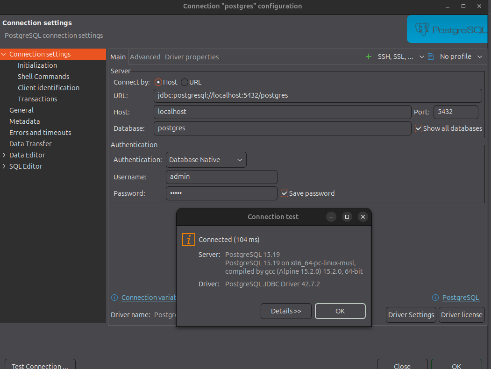

# Development Setup

## Prerequisites

- [Docker](https://docs.docker.com/get-docker/) and Docker Compose installed
- [.NET SDK](https://dotnet.microsoft.com/download) installed
- A database client such as [DBeaver](https://dbeaver.io/) (optional, for inspecting Postgres)

---

## 1. Environment file

Copy `.env.example` to `.env` and adjust the values as needed:

```bash
cp .env.example .env
```

---

## 2. Start the containers

Run `docker-net.sh`. It creates the external Docker network (`db-net`) and starts the `postgres` and `sonarqube` containers.

Verify that everything is up by running:

```bash
docker ps
```

You should see an output similar to:

```text
CONTAINER ID   IMAGE                 COMMAND                  CREATED          STATUS          PORTS                                         NAMES
0d69c2edc29b   sonarqube:community   "/opt/sonarqube/dock…"   6 seconds ago    Up 5 seconds    0.0.0.0:3000->9000/tcp, [::]:3000->9000/tcp   sonarqube
85c16d3f22e9   postgres:15-alpine    "docker-entrypoint.s…"   24 seconds ago   Up 24 seconds   5432/tcp                                      postgres
```

---

## 3. SonarQube

### 3.1 First access

Open SonarQube in your browser:

```text
http://localhost:3000/
```

Log in using the credentials from your `.env` file, then **change the password** immediately on first login.

### 3.2 Create the project

1. Select **"Create a local project"**.
2. Fill in the fields:

   | Field            | Value                  |
   | ---------------- | ---------------------- |
   | Display name     | `portfolio-dotnet-api` |
   | Project key      | `portfolio-dotnet-api` |
   | Main branch name | `main`                 |

3. Select **"Is custom"**, then **"Previous version"** — this lets you create a version for each change.
4. Click **"Create project"**.

### 3.3 Generate a token

In the **"Project onboarding"** screen:

1. Click **"Locally"**.
2. Create a token with **"No expiration"**.
3. **Save both your token and password in a safe place**, then click **"Continue"**.

### 3.4 Analyze the code

Follow the steps shown under **".NET Core"** in the onboarding screen.

Install the scanner tool:

```bash
dotnet tool install --global dotnet-sonarscanner
```

Start the analysis (paste the token generated above where indicated):

```bash
dotnet sonarscanner begin /k:"portfolio-dotnet-api" /d:sonar.host.url="http://localhost:3000" /d:sonar.token="<YOUR_TOKEN>"
```

Build the project:

```bash
dotnet build
```

Finish the analysis (paste the same token):

```bash
dotnet sonarscanner end /d:sonar.token="<YOUR_TOKEN>"
```

Once these steps are complete, your first analysis will be available in SonarQube.

---

## 4. Postgres

Connect to the Postgres instance using the credentials from your `.env` file. Any client that supports PostgreSQL will work — for example, [DBeaver](https://dbeaver.io/).

